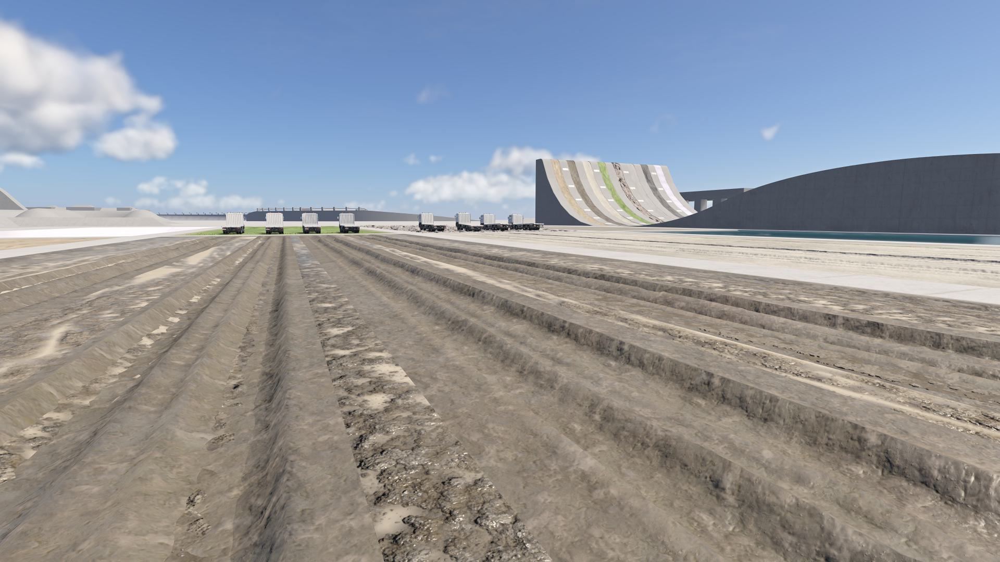
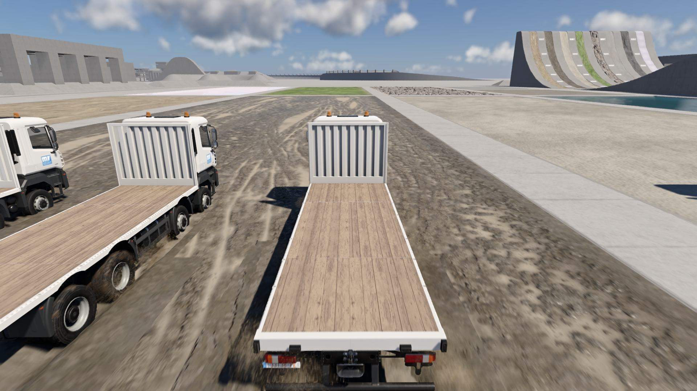
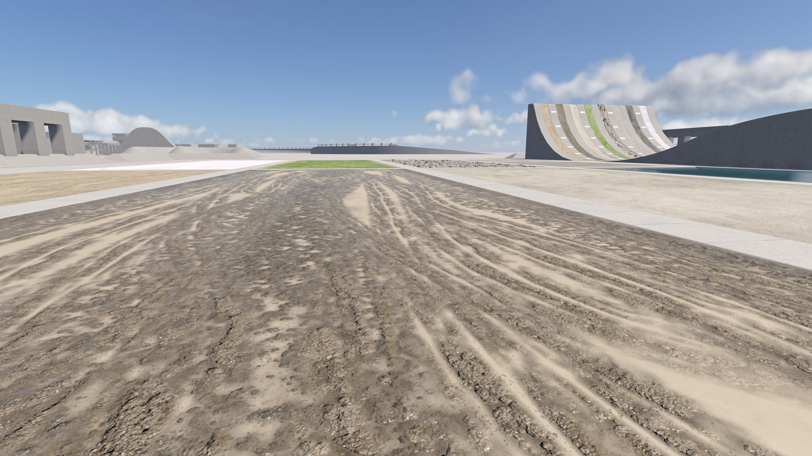
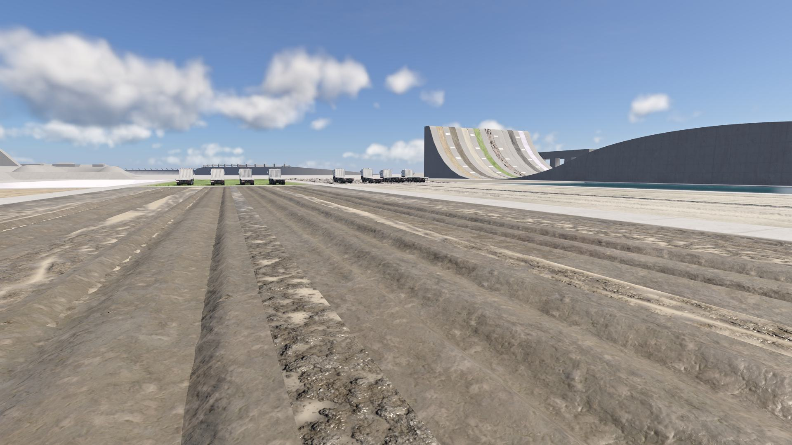

# DeepNode

Terrain deformation for BeamNG.drive 0.40: deep mud and sand that sink, rut and remember every tyre.

**Install:** download `DeepNode-v0.1.0.zip` from [Releases](../../releases) and drop it, unextracted, into
`%LOCALAPPDATA%\BeamNG\BeamNG.drive\current\mods\`. For the best result switch *Physics* to **HEAVY** in
the DeepNode window (Run tab).

## Clean-room build

DeepNode is written from scratch. It uses only BeamNG's public Lua interface. How that interface
behaves was learned from the game's shipped Lua scripts and from measurements in the running game.
No code was taken from other mods or from BeamNG's closed engine source. The engine facts it relies
on are documented in [docs/ENGINE_FINDINGS.md](docs/ENGINE_FINDINGS.md).

## Features

- Mud and sand from the level's own terrain layers (plus optional mud zones per level)
- Tyre ruts at 0.2 m resolution with berms and slumping walls, chassis dents, dual wheels
- Ruts carved ahead of each wheel, so they appear under the tyre (front latency ~0.1 s)
- Heavy physics: deeper ground models and a terrain rut floor that tyres have to climb
- Undug mud stays the level terrain: decal roads, grass and colours as in vanilla, at any distance
- Mud on the tyres, wet tyres, flung mud chunks
- In-game window with live settings and performance readouts

## Benchmarks included

Two repeatable tests with 8 Percheron 8x8 trucks (`tools/benchmark`, see [docs/BENCHMARK.md](docs/BENCHMARK.md)):

- **gridmap_v2 straight run** — 4 trucks through the mud pit, 4 through the sand pit, reset and repeat
- **johnson_valley circles** — each truck on its own 100 m circle at 40 km/h in mud zones

v0.1.0, gridmap_v2, 70 m mud view distance:

| Physics | Fresh mud fps (low 1 %) | Repeat runs fps (low 1 %) | Memory growth (fresh / repeat) |
|---|---|---|---|
| heavy | 45–47 (32–35) | 47.5–49 (37–39) | 63 / 25 MB/min |
| vanilla | 39–41 (25–31) | 34–48 (24–36) | 253 / 132 MB/min |

Mod off on the same machine: 77–84 fps.

## Screenshots

| | |
|---|---|
|  |  |
|  |  |

## Open issues

Details and measurements: [docs/OPEN_ISSUES.md](docs/OPEN_ISSUES.md). Contributions welcome on the `test` branch.

1. Frame rate: ~41 fps with 8 trucks in vanilla mode (60 with the mod off; goal 70–80 fps); every mesh upload also costs engine shadow and reflection time.
2. Ruts deepened by the axles behind the front wheel can lag up to ~4 s under heavy load.
3. Rut updates are 30–40 Hz for fresh ruts in view, not for every wheel.
4. Sand is still fully meshed (no terrain-first drawing for sand yet).
5. Vanilla physics mode: full mud mesh, alpha-clipped decal copies, high memory growth.
6. Dug areas lose the decal-road pattern; the change at the rut edge is visible up close.
7. Tyre mud costs ~1.6 ms per frame with 8 trucks.
8. Heavy physics slows Percherons to ~3–4 m/s in deep mud.
9. johnson_valley benchmark not yet re-run with the current code.
10. Vehicle reports are Lua strings compiled by the game (~160 per second); a compact format would save time.
11. Tyre mud textures are baked from BeamNG's decal textures: check redistribution terms.

## License

MIT — see [LICENSE](LICENSE).
